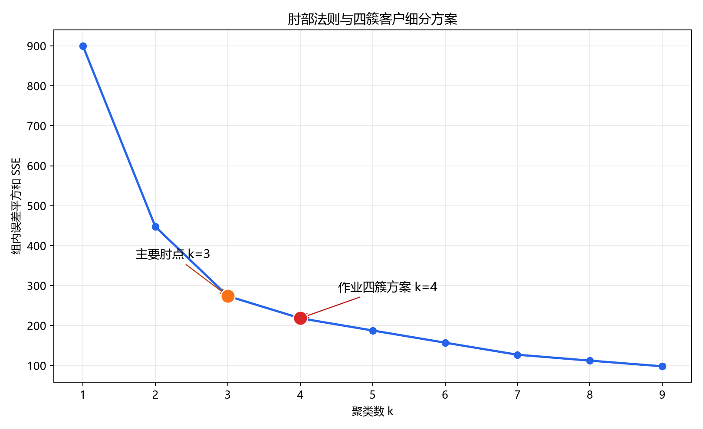
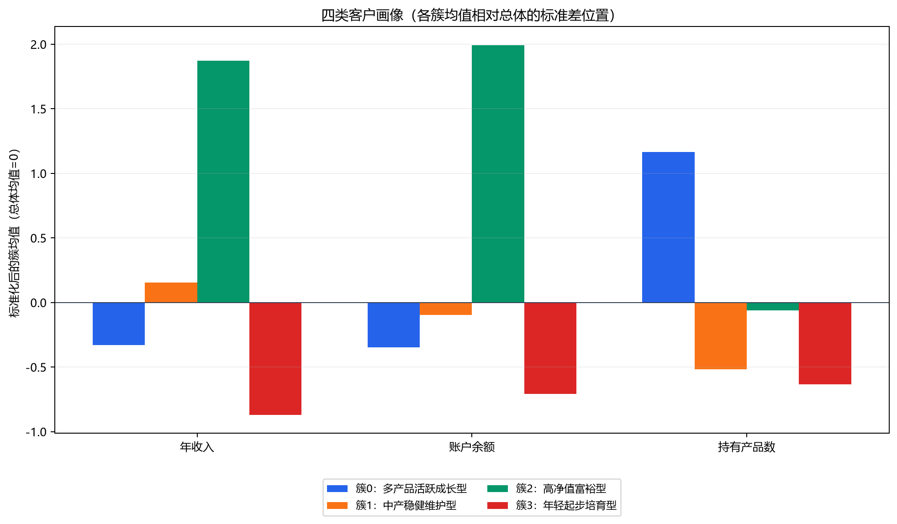
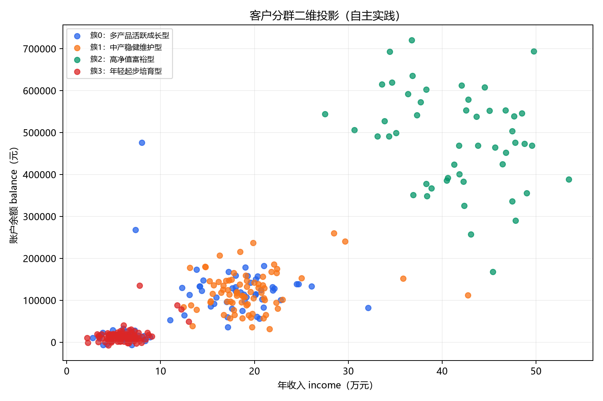
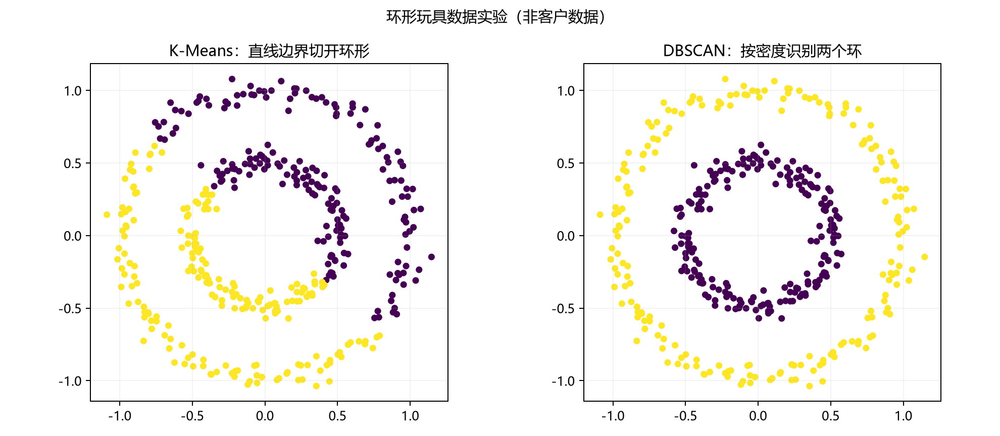
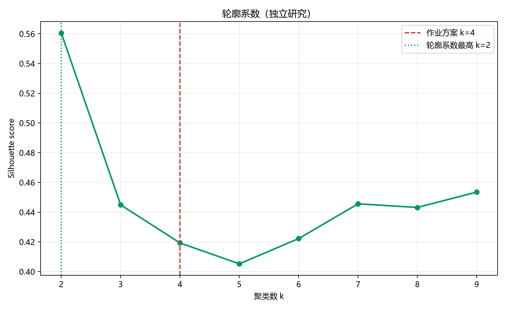

# 进度报告·第 9 次课：聚类客户分群

学号：＿＿＿＿　姓名：＿＿＿＿　日期：2026-11-14（课程日期：11/13）  
仓库：`lesson09-cluster`（每次作业独立建仓）  
远程仓库地址：[https://github.com/ynu-Linzitong/lesson09-cluster](https://github.com/ynu-Linzitong/lesson09-cluster)

> **数据来源说明**：因未获得教师指南中的 `bank_customers.csv`，本次经本人确认使用课堂展示包中的 `data/mall_customers_yuan.csv`，共 300 位客户。原文件与作业目录中的副本 SHA-256 完全一致，未生成、补造或修改客户信息。该文件没有 `avg_monthly_spend`、`overdue_count`、`account_age_months`，因此基础聚类改用现有字段 `income`、`balance`、`product_count`；自主实践的“加特征重画像”以现有字段 `age` 替代 `account_age_months`。以下数值和图表均为这份课堂展示数据的实际运行结果，不作为教师原始数据基准。

## 1. 检查点完成情况

| 检查点 | 完成情况 | 结果与证据 |
|---|---|---|
| 检查点 1：四簇人数 | 已完成（课堂展示数据） | 簇 0：85 人；簇 1：76 人；簇 2：50 人；簇 3：89 人，合计 300 人。证据：`outputs/cluster_counts.csv`、`outputs/customer_clusters.csv`。 |
| 检查点 2：肘部图 | 已完成（课堂展示数据） | `k=1..9` 的 SSE 依次为 900.00、447.53、274.09、218.46、187.78、157.30、127.11、112.37、98.20。主要肘点在 **k=3**：`k=2→3` 的 SSE 下降 173.44，而 `k=3→4` 仅下降 55.64，随后下降继续趋缓。为完成作业要求的四簇画像、进一步细分中等收入客户，业务展示采用 **k=4**，并保留这一统计差异说明。证据：`outputs/elbow.png`、`outputs/elbow_scores.csv`。 |
| 检查点 3：画像＋图＋四个中文业务命名 | 已完成（课堂展示数据） | 已输出各簇均值表、标准化分组柱状图和四个中文业务命名，见下表。证据：`outputs/customer_profiles.csv`、`outputs/customer_profiles.png`。 |



### 四簇画像、业务命名与建议

| 簇 | 人数 | 中文业务命名 | 年收入均值（万元） | 余额均值（元） | 产品数量均值 | 年龄均值（岁） | 业务建议 |
|---|---:|---|---:|---:|---:|---:|---|
| 0 | 85 | 多产品活跃成长型 | 13.05 | 78,057.65 | 3.73 | 30.72 | 维护多产品关系，提供权益整合与适配的资产配置，避免脱离实际需求的过度营销。 |
| 1 | 76 | 中产稳健维护型 | 19.31 | 121,446.05 | 1.30 | 36.91 | 提供稳健理财和储蓄计划，在风险适配前提下提高产品渗透与客户黏性。 |
| 2 | 50 | 高净值富裕型 | 41.58 | 483,502.00 | 1.96 | 47.10 | 作为高价值客群重点维护，提供专属财富管理、资产配置和个性化服务。 |
| 3 | 89 | 年轻起步培育型 | 6.07 | 15,694.38 | 1.13 | 21.52 | 提供低门槛储蓄、金融教育和基础产品，长期培养客户关系，审慎开展高额度授信。 |



## 2. 遇到的问题与解决方式

| 问题 | 怎么解决的（AI 怎么帮的／查了什么／自己试了什么） |
|---|---|
| 作业模板字段与课堂展示数据不一致，且没有教师指定的 `bank_customers.csv`。 | 先核对三份 Word 文件和 CSV 表头，确认缺少 `avg_monthly_spend`、`overdue_count`、`account_age_months`。按本人后续确认使用课堂展示数据，基础聚类选择现有的收入、余额、产品数量三个价值／行为字段，加特征任务使用 `age` 替代；在报告开头明确披露替换，未补造客户字段。 |
| 未标准化时，余额会主导欧氏距离。实际数据中 `balance` 标准差约为 173,297.93，而 `income` 和 `product_count` 分别仅约为 12.95 和 1.44。 | 使用 `StandardScaler` 对三个聚类特征逐一标准化后再训练 K-Means，并实际运行未标准化对照。未标准化四簇人数为 20、106、34、140，标准化后为 85、76、50、89，两种归属的 ARI 仅为 0.3879，说明量纲确实显著改变分群。对照见 `outputs/unscaled_customer_profiles.csv`。 |
| 肘部图的主要拐点是 k=3，而作业检查点要求输出四簇人数与四个业务命名。 | 不把 k=4 虚称为统计最优点：图中同时标注主要肘点 k=3 和作业四簇方案 k=4；报告保留 SSE 与轮廓系数证据，将 k=4 解释为用于细分中等收入客群的业务选择。 |

## 3. 自主实践各任务完成度自查

| 任务 | 完成 | 备注 |
|---|---|---|
| 三步全通：K-Means、肘部法则、分群画像 | ☑ | `cluster_analysis.py` 一次运行即可复现；按课堂数据实际字段完成三个检查点。 |
| 检查点：四簇人数、肘部图、画像＋四中文命名 | ☑ | 见第 1 节及 `outputs/` 中 CSV、PNG。 |
| 提交规范：独立目录、代码＋报告＋图 | ◐ | 本地 `lesson09-cluster` 文件已齐备；仍需本人创建远程独立仓库、push 并填写真实地址。 |
| 加特征重画像 | ☑（替代字段） | 原任务字段 `account_age_months` 不存在，改用 `age`。加年龄前后 ARI=0.7088；多产品活跃成长型由 85 人变为 58 人，平均年龄降至 24.69 岁；中产稳健维护型由 76 人变为 99 人，平均年龄为 39.61 岁；高净值富裕型仍为 50 人。说明年龄参与距离计算后，分群更突出生命周期差异。见 `outputs/extended_customer_profiles.csv`。 |
| 三种子稳定性 | ☑ | `random_state=42、7、2026`；三组两两 ARI 均为 1.0000，对齐后最大中心距离为 0。簇编号可能置换，但排序后人数均为 50、76、85、89，客户归属和业务画像不变。见 `outputs/stability_summary.csv`、`outputs/stability_cluster_counts.csv`。 |
| scatter 二维投影着色 | ☑ | 以年收入为横轴、账户余额为纵轴，按簇着色，见 `outputs/cluster_scatter.png`。 |
| AI 使用记录 | ☑ | 见第 5 节，包含指令原文、验证过程和结论。 |



## 4. 独立研究任务

### 4.1 MapReduce 并行 K-Means 解决了什么问题

**题目→我的做法→结论：**阅读 MapReduce 的 Map／Reduce 分工后，将其映射到 K-Means 的“分配—更新”迭代。它解决的是数据量超过单机内存或单机计算耗时过长时，如何拆分数据并行计算的问题。Map 阶段把样本分给最近中心并发出 `(簇编号, 特征向量)`；Reduce 阶段按簇汇总向量和与样本数，计算新中心；多轮迭代直到中心收敛。结论是并行化降低了单节点计算压力，但多轮迭代会产生数据读写和网络通信成本，因此并不是数据越小就越适合分布式。

参考资料：[MapReduce: Simplified Data Processing on Large Clusters](https://www.usenix.org/publications/library/proceedings/osdi04/tech/full_papers/dean/dean.pdf)。

### 4.2 环形数据＋DBSCAN

**题目→我的做法→结论：**使用 `make_circles(n_samples=400, factor=0.5, noise=0.05, random_state=42)` 生成内外双环**算法玩具数据（非客户数据）**，分别运行 K-Means(k=2) 与 DBSCAN(eps=0.18, min_samples=5)。K-Means 与真实环形的 ARI 为 **-0.0024**，只能用近似直线边界切开环形；DBSCAN 的 ARI 为 **1.0000**，识别出 2 个非噪声簇、0 个噪声点。结论是 K-Means 偏向凸形、近似球状且以中心表示的簇，DBSCAN 能按密度发现非凸簇并识别噪声，但结果受 `eps`、`min_samples` 和量纲影响。

证据：`outputs/ring_dbscan_comparison.png`、`outputs/ring_metrics.json`。



### 4.3 轮廓系数 `silhouette_score`

**题目→我的做法→结论：**轮廓系数结合簇内凝聚度 `a` 与最近其他簇的平均距离 `b`，单样本公式为 `(b-a)/max(a,b)`，越接近 1 表示分得越清晰，接近 0 表示位于簇边界，负值表示可能分错。对 `k=2..9` 逐个计算后，**k=2 的轮廓系数最高，为 0.5605**；k=3 为 0.4449，作业采用的 k=4 为 0.4193。这说明本数据的四簇方案是业务细分选择，而不是轮廓系数意义下的统计最优；若只追求最清晰的分离，应优先比较 k=2 或 k=3。

证据：`outputs/silhouette_scores.csv`、`outputs/silhouette.png`。



## 5. AI 使用记录摘要

| 指令原文（关键 1—3 条） | 我怎么验证的 | 结论 |
|---|---|---|
| “你根据这两个截图里面要完成的那个作业，还有这几个文件，帮我把作业做了，生成那个要生成的文件。” | 逐项读取两张截图和三份 DOCX，按验收表拆解任务；实际运行代码后核对四簇人数合计 300，并逐一打开 5 张 PNG 检查标题、中文字体、坐标、标注和图例。 | AI 可帮助组织流程和生成代码，但数值必须来自实际运行，完成度必须对照验收表核验。 |
| “如果客户信息不要你自己生成的。”以及“老师好像没法，你就用这个。课堂展示里面的这个吧。” | 读取课堂展示 CSV 的真实表头和 300 条记录；比较原文件与作业副本的 SHA-256，结果完全一致；删除此前模拟客户文件并用课堂数据重算全部结果，报告中注明字段替代。 | 不补造客户信息；数据来源和字段差异必须明确披露，不能把课堂展示结果冒充教师原始数据基准。 |
| “对数据选取价值／行为特征，标准化后做 KMeans(k=4)，输出各簇人数；再完成肘部图、画像、三种子稳定性、scatter 和轮廓系数。”（依据实践指南与当前字段改写） | 检查必要字段及缺失值；使用 `StandardScaler` 与 `KMeans(n_clusters=4, n_init=50)`；核对 `customer_clusters.csv` 的 `cluster` 列；用 ARI 和中心距离验证三种子稳定性；检查肘部表与轮廓系数表中的实际极值。 | 标准化、业务命名和量化验证缺一不可；当统计指标与作业簇数要求不同，应如实解释而不是选择性报告。 |

## 6. 本课一句话收获

聚类的关键不是机械地把客户分成四堆，而是先选对特征并标准化，再用肘部法则、轮廓系数、稳定性和客户画像让分群结果可验证、可解释、可行动。

## 7. 给教师的留言

本次未获得指南中的 `bank_customers.csv`，经本人确认使用课堂展示数据完成全流程，字段替代与统计指标差异均已在报告中说明；如后续获得教师原始数据，需要按原字段重新运行并更新结果。

---

## 复现与提交

```bash
python -m pip install -r requirements.txt
python cluster_analysis.py
```

- 默认读取 `data/mall_customers_yuan.csv`；无需生成任何客户数据。
- 创建并 push 到本人 GitHub/Gitee 独立仓库后，将雨课堂第 2 题填写为真实地址，例如 `https://github.com/你的用户名/lesson09-cluster`；不要用示例地址直接提交。
